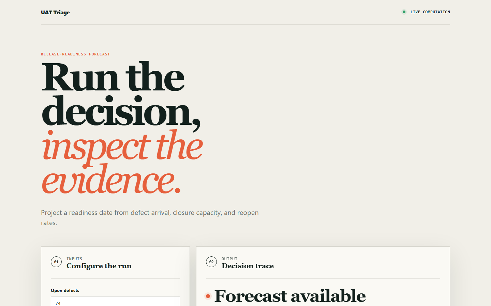
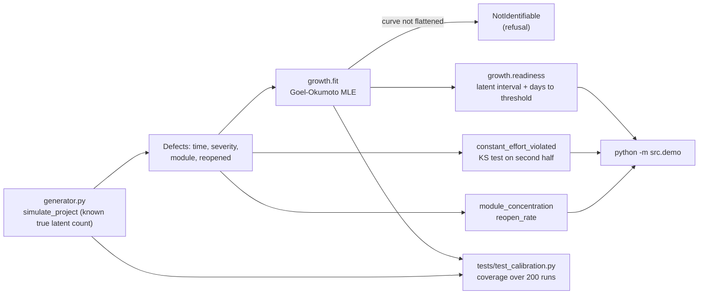

# uattriage

Reliability-growth analytics for user acceptance testing: it answers "are we ready to go live?" with an estimate of the defects still undiscovered and a projected date-to-threshold with an uncertainty band, instead of a count of open defects.

[](https://github.com/SlateGitOrg/uattriage/actions/workflows/ci.yml)
[Live demo](https://slategitorg.github.io/uattriage/)



## Why

UAT can produce 600 defects in three weeks, and the project manager still has to decide whether to go live. Answering honestly means knowing whether the arrival rate is falling, whether severity is shifting, and whether defects cluster in one module. A defect count answers none of those, so the decision ends up resting on confidence. uattriage fits a defect-discovery curve to the arrival times and turns "600 open defects" into "this many undiscovered defects remain, and the severity threshold is this many days away", with the interval stated.

## Features

- Goel-Okumoto (NHPP) fit of defect discovery times, with an interval on the latent defect count.
- Readiness projection per severity: days until the latent count drops below an agreed threshold, taken from the optimistic and pessimistic ends of the interval.
- Refusal when the data cannot support an estimate: too few defects, or a curve that has not flattened (`b*T < 0.7`) raises `NotIdentifiable` instead of returning a runaway number.
- Constant-effort assumption check (a one-sample Kolmogorov-Smirnov test of the second half against a first-half fit) that flags when a change in tester numbers invalidates the projection.
- Triage analytics: severity-1 concentration by module and reopen rate by severity ("closed" is not "fixed").
- A synthetic project generator with a known true latent-defect count, which is what makes the estimate checkable.
- A browser app (`site/`) that runs a simpler backlog burn-down forecast; see Limitations.

## Architecture



Expected cumulative defects follow `m(t) = a(1 - exp(-b t))`, where `a` is total defect content and `b` the discovery rate; latent defects are `a - n`. The generator produces projects with a known `a`, so the tests can compare the fitted interval to the truth.

## Quick start

Requires Python 3.11+ (3.12 in CI) and nothing else: the core uses only the standard library. The browser app tests need Node 24.

```bash
git clone https://github.com/SlateGitOrg/uattriage.git
cd uattriage
python3 -m unittest discover -s tests -v   # 21 tests
python3 -m src.demo                        # readiness report for a simulated project
node --test site/core.test.mjs             # browser app logic tests
python3 scripts/validate_site.py           # site structure check
```

## Usage

`python3 -m src.demo` simulates a 900-defect project (seed 20260911) and prints the readiness view. Trimmed output:

```
  807 defects raised over 45 days of UAT.

    severity    found      latent (95%)   days to threshold
    sev1           60              0-68               0-114
    sev2          211              0-62                0-14
    sev3          536             8-119                 0-3

    Binding constraint: sev1: 0-68 undiscovered defects remain; 0-114 days to threshold 2

  ASSUMPTION CHECK
    constant test effort: holds
    same project with the team doubled at the halfway point: VIOLATED

  THE REFUSAL
    Same project, asked after only 10 days:
      REFUSED: discovery has not flattened (b*T = 0.00 < 0.7); keep testing before projecting

  TRIAGE
    severity-1 concentration by module:
      payments          18  (30%)
      eligibility       14  (23%)
      reporting         11  (18%)
    sev1 reopen rate: 22%   sev3: 9%
```

From Python:

```python
from src.generator import simulate_project
from src.growth import readiness

project = simulate_project(total_defects=900, seed=1)
r = readiness(project.times("sev3"), project.horizon, "sev3", threshold=60)
print(r.describe())
```

## How it works

- **Fit.** `growth.fit` solves for the discovery rate `b` by maximum likelihood over `[0, horizon]`, derives `a`, and builds an interval on the latent count. The interval is deliberately conservative; a test checks it is still narrow enough to be informative.
- **Identifiability guard.** The Goel-Okumoto estimate degenerates when the curve has not flattened. `fit` refuses when `b*T < 0.7` (roughly half the defect content found), when fewer than 5 defects exist, or when the implied total exceeds 3x the defects found. The demo shows the unguarded value for a 10-day-old project: about 25.9 billion latent defects.
- **Readiness.** `readiness` builds an optimistic and a pessimistic curve from the ends of the latent interval and solves each for the days until the latent count falls below the threshold. That gives a window, not a date.
- **Assumption check.** Under constant test effort the second half's arrival times should follow the curve fitted to the first half. `constant_effort_violated` tests that out of sample with a KS statistic. Two simpler approaches (comparing half-counts, comparing the second-half count to the prediction) were rejected because of poor detection rates; the reasoning is in the docstring.
- **Reading the demo window.** In the demo, severity 1 has too few defects for a tight band (0-68 latent). That width is the honest answer for 60 data points.

See [docs/ARCHITECTURE.md](docs/ARCHITECTURE.md) for decisions and failure modes.

## Testing

```bash
python3 -m unittest discover -s tests -v
```

`tests/test_calibration.py` covers:

- **Calibration**: the 95% interval covers the generator's true sev3 latent count across 200 simulated runs (asserted above 80% of usable runs; the interval over-covers by design), and the point estimate is not systematically biased.
- **Informativeness**: mean truth plus mean interval width stays under 65% of the 900-defect total.
- **Fit**: recovery of the true rate and total, fewer latent defects with longer testing, refusal on too-few or unflattened data, and the same project becoming estimable with more testing.
- **Readiness**: dated windows, tighter thresholds take longer, interval on days reflects interval on defects.
- **Assumption checks and triage analytics**: effort step detection, module concentration, reopen rates.

`site/core.test.mjs` tests the browser app's forecast logic. CI runs both on every push, then deploys `site/` to GitHub Pages.

## Project layout

```
src/
  generator.py   synthetic projects with known latent defect counts
  growth.py      Goel-Okumoto fit, readiness window, assumption checks
  demo.py        python -m src.demo
tests/           calibration, fit, readiness and triage tests
site/            browser app (index.html, app.mjs, core.mjs, core.test.mjs)
scripts/         validate_site.py
docs/            architecture notes and screenshots
```

## Limitations

- The model assumes constant test effort and stable scope. The effort check catches a mid-test step change, not every violation.
- Only the Goel-Okumoto model is implemented; there is no S-shaped model or model comparison.
- Data is synthetic. The generator is not calibrated against real defect datasets, and there is no importer for a defect tracker.
- The browser app in `site/` is a separate, simpler tool: it projects days to a backlog threshold from open count, arrival rate, closure capacity and reopen rate. It does not run the reliability-growth fit.

## License

MIT — see [LICENSE](LICENSE).
