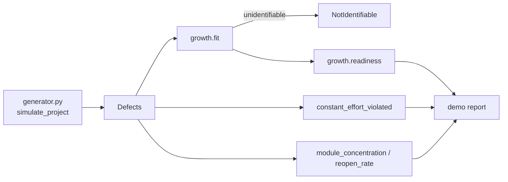

# Architecture

## Context

UAT teams are asked whether a system is ready to go live. The usual evidence is a count of open defects by severity, which says nothing about how many defects remain undiscovered or how long until the severity threshold is met. uattriage estimates both from defect discovery times and states the uncertainty.

## Container view

All logic is pure Python with no dependencies. The generator returns a `Project` that carries the true total defect content per severity, so tests can check estimates against ground truth. `site/` is an independent browser app with its own forecast logic in `core.mjs`.

## Key decisions

- **Goel-Okumoto NHPP.** `m(t) = a(1 - exp(-b t))` gives both a latent count (`a - n`) and a time to threshold, and has a closed-form likelihood in `b`. Alternative: S-shaped models; not implemented.
- **Calibration over a single fit.** Interval quality is tested by coverage across 200 simulated projects. The interval is conservative (it over-covers), which is the safe direction for a go-live decision, and a second test ensures it remains narrow enough to carry information.
- **Window, not a date.** Readiness is solved on both ends of the latent interval, so the output is a range of days.
- **Refuse rather than guess.** See below.

## Failure modes

- **Curve has not flattened.** The estimate of `a` degenerates. `fit` raises `NotIdentifiable` when `b*T < 0.7`, when there are fewer than 5 defects, or when the implied total exceeds 3x the defects found. `strict=False` exists only to inspect the degenerate fit.
- **Test effort changed mid-UAT.** The curve flattens for reasons unrelated to defect depletion, which makes the projection too optimistic. `constant_effort_violated` fits the first half and tests the second half with a KS statistic.
- **Sparse severities.** Few defects give wide intervals (the demo's severity 1 shows 0-68 latent). The width is reported as is.

## Out of scope

- Importing from a defect tracker.
- Non-constant effort models and S-shaped growth models.
- Calibration against real defect datasets.
